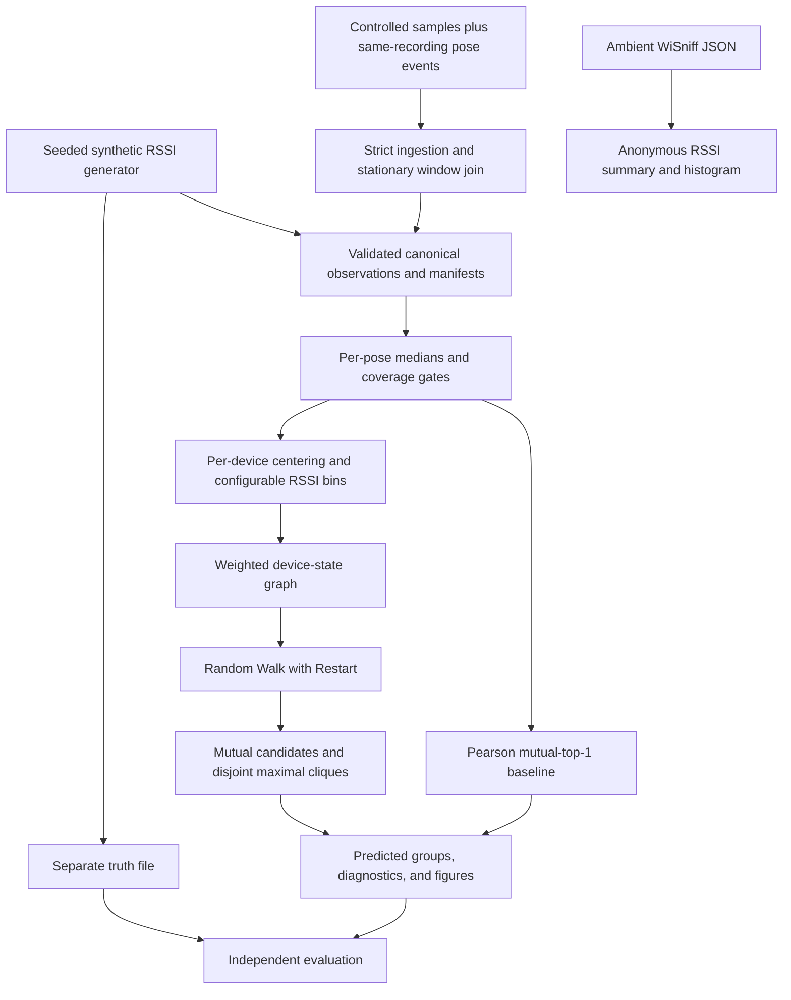

# Report #1 offline analysis

This package implements the RSSI-only software deliverable in the root [implementation spec](../ECE9500_Report1_Low_Level_Spec_v2.md). The [teammate guide](../Report1_README.md) describes the command flags and experiment settings. The original report environment uses Python **3.11**; Python **3.13** uses a separate NumPy pin for compatibility.

## Set up and run

From the repository root:

```bash
cd analysis
python3.11 -m venv .venv
source .venv/bin/activate
python -m pip install -r requirements.txt
python -m pytest -q

python -m colocation.cli synthesize --config config/report1.json --seed 9500 --out data/processed/synth001
python -m colocation.cli infer --input data/processed/synth001/observations.jsonl --config config/report1.json --out outputs/synth001
python -m colocation.cli evaluate --predictions outputs/synth001/groups.json --truth data/processed/synth001/truth.json --out outputs/synth001/metrics.json
```

Windows PowerShell activation: `.venv\Scripts\Activate.ps1`. On Windows, `py -3.11 -m venv .venv` selects Python 3.11. Dependencies are pinned in `requirements.txt`: Python 3.11/3.12 selects NumPy 1.26.4, while Python 3.13 selects NumPy 2.2.6. Keep commands in `analysis/`; `python -m colocation.cli --help` and each subcommand's `--help` show the accepted flags. Generated outputs, local virtual environments, caches, and private raw captures are ignored by Git.

### Raspberry Pi 4: Debian 13, ARM64, Python 3.13

Install the OS tools in the Pi's SSH terminal:

```bash
sudo apt update
sudo apt install -y git python3-venv
```

Transfer the updated project source to the Pi, then run from its `analysis/` directory:

```bash
python3 -m venv .venv
source .venv/bin/activate
python -m pip install --upgrade pip
python -m pip install -r requirements.txt
python -m pytest -q
```

Create this environment on the Pi; do not copy a Mac `.venv`. Keep dependencies inside the virtual environment. The conditional NumPy requirement is selected automatically, so the system Python does not need to be replaced. All 207 tests passed locally under Python 3.13 with NumPy 2.2.6, and dependencies resolved to Linux ARM64 wheels. These are compatibility checks; run the tests above on the actual Pi to verify its environment. The original report evidence remains associated with its recorded Python/NumPy versions.

To reproduce the full documented CLI workflow, generalization scenarios, and tracked figures:

```bash
python run_report1.py
```

This writes the machine-readable [acceptance summary](report1_evidence/acceptance_summary.json) and anonymized figures under `report1_evidence/`. Read its [evidence notes](report1_evidence/README.md) for results and limitations. It does not perform a hardware capture.

## Data flow



Inference accepts the same JSONL `Observation` schema for synthetic and controlled captures. It does not inspect group truth, generator geometry, or data source to decide groups. `devices.json` is read automatically beside the observations, or selected with `infer --devices ...`; known devices without usable samples remain singletons. Without a manifest, fully unseen transmitters cannot be discovered.

The per-device center is the mean of retained per-pose RSSI medians. It is subtracted before assigning bins; thresholds are left-closed/right-open, so a value equal to a threshold enters the upper bin. Shared state keys include trial, receiver, pose, and bin. Raw count weights are capped by configuration, normalized per device, and reused in both directions before row-normalizing random-walk transitions.

Mutual graph candidates use at most `K−1` other devices, require positive scores in both directions, and honor the configured minimum. Maximal cliques are selected by descending size, then summed mutual score, then lexical IDs; overlapping candidates are skipped and unmatched devices become singletons. The Pearson comparator uses shared receiver/pose observations and **mutual top-1**, even for `K=3`. Its result is a simple pair baseline. A graph-versus-baseline difference for triples therefore also reflects their unequal allowed group sizes.

## Synthetic assumptions

The toy propagation model uses a one-dimensional receiver path, uniform device offsets within `±group_spread_m`, persistent Gaussian transmitter offsets, Gaussian packet noise, and independent packet dropout. The approved defaults include:

- `reference_rssi_dbm = -40.0` at 1 m.
- `shared_environment_sd_db = 1.0`, drawn once per true group and pose and shared by its devices.
- A 0.5 m distance floor in the path-loss calculation.

Generated uptime windows are explicitly simulated. Configurations producing samples outside −120…0 dBm fail instead of clipping measurements. The seed and effective configuration are recorded; changing parameters is an experimental change and should be reported.

## Exercise capture ingestion without hardware

The committed fixtures are invented headerless CSI data from one labeled transmitter, with three stationary poses and movement/settling samples:

```bash
python -m colocation.cli ingest-capture \
  --input tests/fixtures/capture_samples.csv \
  --events tests/fixtures/pose_events.csv \
  --poses tests/fixtures/poses.csv \
  --format csi-legacy --trial-id fixture001 --receiver-id RX1 \
  --single-known-transmitter --device-id T1 \
  --config config/report1.json --out data/processed/fixture001

python -m colocation.cli infer \
  --input data/processed/fixture001/observations.jsonl \
  --config config/report1.json --out outputs/fixture001
```

The fixture produces **9 accepted** stationary samples and **6 excluded** movement/settling/gap samples. Its inference result is the one transmitter as a singleton. This verifies file handling and diagnostics rather than colocation.

For actual captures, provide sample, event, and independently recorded pose-manifest CSVs as described in the teammate guide. Header names are strict; column order may vary. Observed CSVs require `device_id` per sample. Legacy CSI requires both `--single-known-transmitter` and `--device-id`; its sentinel is separate from its magnitude vector. The exploratory `ingest-csi` command accepts a manually asserted single-transmitter label but leaves poses unknown, so its output cannot pass spatial inference.

Sample/event files must come from **the same ESP32 recording**. The tool checks nondecreasing uptime, strictly increasing event indices, one receiver's metadata, known poses, and complete nonoverlapping `[start,end)` windows. It cannot prove recording provenance when unrelated sessions happen to have overlapping uptime ranges. No clock alignment is guessed. Timestamps equal to a capture end are excluded unless another complete capture starts there.

Read `ingest_report.json`: it records accepted/excluded counts, movement/settling/gap exclusions, per-device/pose coverage, and clock-provenance limits. Devices seen only outside stationary windows remain in the device manifest. Malformed metadata or no positioned samples produces a nonzero command result; the CLI writes a rejected-status report. A sparse cell may be retained in canonical observations but excluded by inference's configured packet/pose quality gates.

Pose-event emission, LED cues, logger event persistence, flashing, and physical collection are deferred. Existing firmware and `wisniff/tools/csi_data.py` are unchanged by this offline package.

## Outputs and evaluation

`synthesize` writes observations, device/pose manifests, `trial.json`, separate truth, `config_used.json`, and `provenance.json` with `source`, `trial_id`, and `random_seed`. Capture ingestion also writes `trial.json` and recording provenance. `infer` writes:

- `groups.json`: an object with `trial_id`, `groups`, `baseline_groups`, and `metadata`.
- `device_similarity.csv`, `similarity_heatmap.png`, and `device_similarity_graph.png`.
- `rssi_by_pose.png`, `rssistate_graph.png`, and `observations_summary.json`.
- `config_used.json`, `provenance.json`, and the ingestion report when available beside the input.

Groups are deterministic sorted lists and partition every observed/manifest-listed device exactly once. Under-covered devices receive singleton diagnostics. Fewer than two eligible devices yields insufficient-grouping-evidence diagnostics. A single transmitter can demonstrate a trajectory but cannot evaluate colocation.

`evaluate` reads independent truth and rejects mismatched trial IDs, device sets, or duplicate group assignments. Its main metrics are `pairwise_precision`, `pairwise_recall`, `pairwise_f1`, and `count_absolute_error`, with `predicted_group_count`, `true_group_count`, `device_count`, `true_positive_pairs`, `false_positive_pairs`, and `false_negative_pairs` for interpretation. When baseline predictions are present, `pearson_baseline` contains the same metric fields; `graph_minus_baseline_pairwise_f1` records the F1 difference and `graph_improved_pairwise_f1` is true only for a strictly positive difference.

For empty positive-pair sets, precision is 1 only when **both** predicted and true pair sets are empty; otherwise an empty prediction set has precision 0. Recall is 1 whenever truth contains no positive pairs. F1 follows the harmonic mean, with 0 when precision plus recall is 0. Identical singleton-only partitions therefore score F1 1. Count error is the absolute difference in group counts.

`summarize-wisniff` writes an RSSI histogram and anonymous summary; it does not infer groups. The supplied scan has 40 records and 18 source-MAC strings, which are represented only by scan-local aliases in parsed observations. Those counts do not measure people or ownership.

## Evidence and limits

The tracked [`report1_evidence/`](report1_evidence/) artifacts contain anonymized software results and figures, with configuration and seeds. Full reproducible runs live in ignored `outputs/` and `data/processed/`. Tests cover schema failures, the supplied exploratory captures, exact bin boundaries, graph normalization and convergence, pairing/clique policy, arbitrary IDs/counts, missing coverage, negative controls, and source equivalence.

Successful synthetic grouping demonstrates this implementation on a designed model. Controlled hardware measurements are still required to test RF colocation. Physical proximity does not establish common ownership, and observable device groups do not establish total crowd size.
