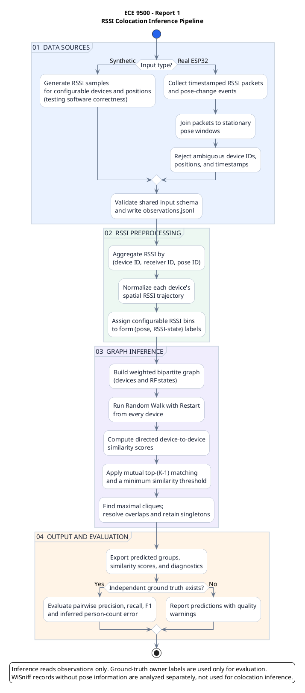

# ECE 9500 — Report #1 Low-Level Implementation Specification (v2)

**Project:** Device Constellations: Passive Wireless Sensing for Person-Level Crowd Estimation  
**Repository:** [`jellyboston/ece9500-device-colocation-project`](https://github.com/jellyboston/ece9500-device-colocation-project)  
**Target:** November 9, 2026, 11:59 p.m. Eastern  
**Status:** implementation plan, not completed results  
**Revision (v2):** generalized inference contract, real-capture ingestion, and extended acceptance tests. The companion [`Report1_README.md`](Report1_README.md) is the teammate-facing quick start.

## 0. Instructions for a developer or coding agent

You are extending the **existing repository**, not replacing its ESP32 firmware. Work on an **RSSI-only, offline GraphTrack-inspired prototype** for Progress Report #1. The authoritative scope is the team's *ECE Abstract and Full Proposal*, not every stretch idea in the deep-research report. Implement Python analysis separately from the PlatformIO firmware. Do not require the robot, CSI clustering, real-time streaming, Bluetooth, or an HTTP server for the primary deliverable.

**Definition of done:** The default **illustrative acceptance fixture** generates observations from four transmitters and aims to recover **`{M1,D1}` and `{M2,D2}`** using per-position RSSI states, a weighted device–state graph, Random Walk with Restart (RWwR), a mutual-match similarity graph, and clique grouping. **The inference code must not refer to those four IDs, assume four devices/two people, or read ground truth.** Add automated cases with different counts, group sizes, singleton devices, missing poses, and uneven packet coverage. A separate WiSniff command summarizes real ambient RSSI without pretending to infer colocation. Implement a **real-capture adapter** that joins timestamped ESP32 measurements to explicit position events and produces the same canonical observation format as the synthetic generator. Hardware experiments are optional; ingestion validation/tests are required. Add diagrams, unit tests, and figures.

**Rules:** Preserve the current working capture path; use a feature branch; prefer small modules and deterministic tests. Keep person/group truth in a file used only by `evaluate`. Inference must depend only on validated observations and config, **regardless of source**. Never infer a real person's identity or group membership from uncontrolled campus traffic. Do not commit raw identifying MAC data, secrets, or passwords. If time is short, finish and test the synthetic pipeline and the capture-adapter tests before modifying firmware. Do not claim that synthetic success proves real-world RF colocation.

## 1. What the current repository actually contains

| Existing file | Actual purpose / implementation note |
|---|---|
| [`README.md`](https://github.com/jellyboston/ece9500-device-colocation-project/blob/main/README.md) | Basic PlatformIO setup guidance; not yet an analysis-package guide. It contains connection details; **do not copy credentials into new documentation**. |
| [`wisniff/platformio.ini`](https://github.com/jellyboston/ece9500-device-colocation-project/blob/main/wisniff/platformio.ini) | PlatformIO **Arduino** environment `esp32-c61-devkitc1-n8r2`, channel **6**, monitor **921600 baud**. Requires local `private_build_flags.ini`, currently ignored by Git. Confirm the physical board before flashing: this config is **C61**, while the proposal mentions C5/C6. |
| [`wisniff/src/main.cpp`](https://github.com/jellyboston/ece9500-device-colocation-project/blob/main/wisniff/src/main.cpp) | ESP-NOW transmitter/CSI receiver selected by `#define ROLE` (`0=TX`, `1=RX`; currently `1`). RX learns the **first matching transmitter MAC**, then filters CSI to it. Therefore current CSI output is **single-peer**, not simultaneous multi-device capture. |
| [`wisniff/tools/csi_data.py`](https://github.com/jellyboston/ece9500-device-colocation-project/blob/main/wisniff/tools/csi_data.py) | Python serial reader and live CSI heatmap. Saves raw `CSI,...` lines to `csi_<port>_<time>.csv` relative to its **current working directory**. Prints `# ...` status lines, but does **not** store event markers. |
| [`wisniff/data/wisniff_data.json`](https://github.com/jellyboston/ece9500-device-colocation-project/blob/main/wisniff/data/wisniff_data.json) | Ambient probe-request dataset, no per-record timestamps, receiver positions, receiver IDs, or known ownership labels. |
| `wisniff/tools/csi_COM6_*.csv` | Existing single-link CSI captures, useful for parser tests. |
| `wisniff/src/wifijson` | An **inactive, commented** older sniffer draft; it is not the main firmware entry point. |

**Verified current CSV wire format** from `main.cpp`:

```text
CSI,<device_millis>,<rssi_dbm>,<channel>,<n_subcarriers>,0,<mag_0>,...,<mag_n-1>
```

The literal `0` after the subcarrier count is a **placeholder/sentinel**, not subcarrier zero. In `csi_data.py`, CSI values correctly begin at CSV index **6**. Example from the supplied capture: `CSI,6605,-39,6,57,0,14,14,...`. Current rows do **not** carry the transmitter ID; the receiver binds to one peer. The timestamp is **ESP32 uptime from `millis()`**, not a wall-clock timestamp. The magnitudes are already calculated in firmware from CSI real/imaginary components using an integer square-root approximation. Do **not** reinterpret them as raw complex CSI.

**Existing data sanity checks (from uploaded copies):** WiSniff has 40 records, 18 unique MACs, RSSI −93 to −33 dBm; the short CSI CSV has 42 rows, 57 magnitude entries/row, RSSI −40 to −36 dBm. These are exploratory data, not labeled device constellations.

## 2. Scope and success criteria

### Required by Report #1

1. **Synthetic RSSI demo:** Default fixture: 4 stable, anonymous devices (`M1`, `D1`, `M2`, `D2`), 2 true groups (`G1={M1,D1}`, `G2={M2,D2}`), ≥8 known receiver poses, several packets per device/pose, device-specific power offsets and noise. The *fixture* may name devices this way; the *inference algorithm* may not. Other device IDs and counts must work unchanged.
2. **Pipeline:** parse → validate → aggregate by pose → per-device RSSI normalization → configurable discrete RF states → weighted bipartite graph → RWwR → directional device similarities → mutual top-`K−1` edges (`K_devices` configurable; default 2) → maximal-clique grouping with disjoint outputs and singleton handling.
3. **Baseline:** Pearson correlation of per-device normalized RSSI trajectories, using shared poses.
4. **Evidence:** synthetic RSSI-vs-position plot, device-similarity matrix, final similarity graph, predicted groups, and comparison to truth (precision, recall, pairwise F1, and count error).
5. **Real-data exploration:** parse WiSniff JSON, summarize unique observed MACs, count repeated records, plot RSSI range/distribution, and explain why this capture cannot validate colocation.
6. **Generalization acceptance:** test at least 4 devices/2 pairs, 6 devices/3 pairs, 5 devices/2 pairs + singleton, 6 devices/2 groups of 3 (`K=3`), and incomplete/uneven observations; measure results rather than assume each case succeeds.
7. **Real-capture ingestion implementation:** implement `ingest-capture` and its parser/event-window join, validation and data-quality report. Test it against a **small synthetic serial/event fixture** so a physical experiment is not required for Report #1. A staged real capture is an optional hardware demonstration.

### Optional, ordered by value

- **A.** **Running** the timed **single-receiver, single-transmitter** physical position experiment; useful for validating position labels, capture timing, and RSSI trajectory logging, **not** four-device grouping. The parser for such captures is required, the hardware run optional.
- **B.** Multi-transmitter controlled capture after firmware is enhanced to attach a stable `device_id` to each observation; then run the same offline Python pipeline.
- **C.** Parse and plot CSI magnitudes; defer CSI state clustering and RSSI–CSI OR fusion to Report #2.

### Exclusions

Do not require a robot, wheel odometry, RSSI differences between two receivers, CSI graph, k-means, automatic MAC re-identification, online API, or crowd-count accuracy claims on real users. **Differential RSSI requires paired L/R receiver measurements and is explicitly not available in this single-receiver prototype.** Real-input support means processing sufficiently instrumented *controlled* captures; it does not mean pretending the ambient WiSniff JSON is pose-labeled.

## 3. Proposed file layout

Create the following **new** root-level documentation and `analysis/` directory; do not move the existing `wisniff/` directory:

```text
Report1_README.md           # teammate-facing CLI / workflow cheatsheet at repo root
ECE9500_Report1_Low_Level_Spec_v2.md   # this implementation spec at repo root
analysis/
  requirements.txt
  config/report1.json
  colocation/
    __init__.py
    cli.py                  # command-line entry points
    models.py               # validated record types
    ingest.py               # WiSniff JSON + CSI CSV adapters
    capture.py              # time/pose event joining + validation for real captures
    synthetic.py            # seeded, physically motivated RSSI generator
    features.py             # pose aggregation, normalization, RF bins
    graph.py                # weighted bipartite graph
    rwr.py                  # random walk with restart
    grouping.py             # mutual matches, maximal cliques
    baseline.py             # Pearson similarity
    evaluate.py             # pairwise metrics and count error
    plots.py                # report figures
  tests/
    test_ingest.py
    test_capture.py         # phase windows, IDs, resets, incomplete coverage
    test_features.py
    test_rwr.py
    test_grouping.py
    test_end_to_end.py
    test_generalization.py  # arbitrary IDs, K values, gaps, singleton devices
  data/processed/           # generated; .gitignore
  outputs/                  # generated; .gitignore
  README.md                 # optional developer-level install notes
```

Add `.gitignore` patterns for `analysis/.venv/`, `analysis/data/processed/`, `analysis/outputs/`, `__pycache__/`, and private raw capture folders. Keep synthetic fixtures, code, config, and anonymized summary figures under version control. **Keep both Markdown files at repo root**; all documented commands assume the working directory is `analysis/`.

**Source independence rule:** Both `synthesize` and `ingest-capture` must write `observations.jsonl` conforming to the *same* model below. `infer` accepts only that model and does not branch based on `Trial.source`. Source-specific parsing belongs exclusively in ingestion adapters.

## 4. Environment setup (VS Code)

**Python analysis (recommended first):**

1. Install Git, Python **3.11+**, and VS Code; open the **repository root** in VS Code.
2. Create a branch: `git checkout -b report1-rssi-pipeline`.
3. In VS Code Terminal:

```bash
cd analysis
python3 -m venv .venv
source .venv/bin/activate                # macOS/Linux
# Windows PowerShell: .venv\Scripts\Activate.ps1
python -m pip install --upgrade pip
python -m pip install -r requirements.txt
python -m pytest -q
```

Put these packages in `analysis/requirements.txt` (pin exact versions after a working install):

```text
numpy
pandas
networkx
matplotlib
pyserial
pytest
```

4. In VS Code, run **Python: Select Interpreter**, choose `analysis/.venv`, and use the integrated terminal to execute the commands below.
5. Existing real captures are available under `../wisniff/data/` and `../wisniff/tools/`; avoid copying private raw MAC-level captures into public generated output.

**Firmware (only for optional position test):** Install VS Code's **PlatformIO IDE** extension. Open `wisniff/` as the PlatformIO project (not `analysis/`). Confirm the attached board is the model declared in `platformio.ini`; do not flash a C5/C6 with a C61 target by assumption. The checked-in config contains:

```ini
[platformio]
extra_configs = private_build_flags.ini
```

If absent, create **local** `wisniff/private_build_flags.ini`:

```ini
[security]
build_flags =
```

This satisfies the `${security.build_flags}` reference without adding credentials; leave it ignored by Git. Check with your teammate before replacing any local configuration already in use. Select `env:esp32-c61-devkitc1-n8r2`, then **Build** and **Upload** from PlatformIO. Set the port visible in your OS (Windows `COM6`, macOS `/dev/cu.usbmodem...`, Linux `/dev/ttyACM...`). Monitor speed is `921600`; do not open the same serial port simultaneously in the monitor and Python logger. For a TX board, use `ROLE=0`; for RX use `ROLE=1`—this is currently a **source-level compile-time setting**, not a runtime switch. Check connected LEDs/pins before changing them; **three independently controllable LEDs are not guaranteed** on this board.

## 5. Component diagram (PlantUML)

Paste into a [PlantUML](https://plantuml.com/component-diagram) editor. Solid arrows denote data flow; the optional path is labeled.



## 6. Data models and schema

**Canonical transport:** UTF-8 **JSON Lines** (`.jsonl`; one object per line), with explicit keys. The schema below is an implementation contract, not the format currently emitted by ESP32. Raw files remain unchanged; adapters create canonical records. String enums are case-sensitive. Units belong in names.

| Model / table | Fields (type; `?` optional) | Primary key | Foreign keys / rules |
|---|---|---|---|
| `Trial` | `trial_id: str`, `source: enum[synthetic,serial,wisniff]`, `channel: int?`, `notes: str?` | `trial_id` | Channel 1–14 if provided; one independent capture/run. **`source` is provenance only**, not a branching input to inference. |
| `Device` | `trial_id: str`, `device_id: str`, `mac: str?`, `device_kind: str?` | `(trial_id,device_id)` | `trial_id → Trial`; use synthetic IDs or consented stable experiment IDs; MAC optional. |
| `Pose` | `trial_id: str`, `pose_id: str`, `pose_index: int`, `x_m: float?`, `y_m: float?`, `capture_start_ms: int?`, `capture_end_ms: int?` | `(trial_id,pose_id)` | Unique `(trial_id,pose_index)`; `x_m/y_m` only when measured, otherwise null. |
| `Observation` | `trial_id: str`, `receiver_id: str`, `sample_index: int`, `device_id: str`, `pose_id: str?`, `device_time_ms: int?`, `host_time_utc: str?`, `rssi_dbm: float`, `channel: int?`, `csi_magnitudes: list[int]?` | `(trial_id,receiver_id,sample_index)` | `device_id → Device`, `pose_id → Pose` if nonnull; RSSI finite, plausible −120…0 dBm; `sample_index` assigned in input order; no inferred pose in legacy data. |
| `PositionEvent` | `trial_id: str`, `receiver_id: str`, `event_index: int`, `device_time_ms: int`, `pose_id: str`, `phase: enum[CAPTURE_START,CAPTURE_END,MOVE_START,MOVE_END,SETTLE_START]` | `(trial_id,receiver_id,event_index)` | `pose_id → Pose` if known; timestamp in the **same receiver uptime clock** as sample. `MOVE_START` may name old pose; `MOVE_END`/`SETTLE_START` may name destination pose. **Only matched `CAPTURE_START/END` defines an assignable window.** |
| `Truth` (test-only) | `trial_id: str`, `device_id: str`, `group_id: str` | `(trial_id,device_id)` | `device_id → Device`; stored in **separate file**; never an inference input. |
| `RFState` | `trial_id: str`, `receiver_id: str`, `pose_id: str`, `bin_index: int`, `name: str` | `(trial_id,receiver_id,pose_id,bin_index)` | A *shared* state, not one node per sample; stable bin definitions from config. |
| `StateEdge` | `trial_id: str`, `device_id: str`, `receiver_id: str`, `pose_id: str`, `bin_index: int`, `weight: float` | `(trial_id,device_id,receiver_id,pose_id,bin_index)` | Weight > 0; foreign keys to Device and RFState. |
| `Similarity` | `trial_id: str`, `source_device_id: str`, `target_device_id: str`, `method: enum[rwr,pearson]`, `score: float` | `(trial_id,source_device_id,target_device_id,method)` | Direction matters for RWwR; self-pairs excluded from ranking. |
| `Prediction` | `trial_id: str`, `predicted_group_id: str`, `device_id: str` | `(trial_id,predicted_group_id,device_id)` | Exactly **one group per device** after overlap resolution; singletons allowed. Cannot depend on `Truth`. |
| `CaptureQuality` | `trial_id: str`, `source_file: str`, `total_rows: int`, `accepted_rows: int`, `excluded_rows: int`, `counts_by_reason: dict[str,int]`, `per_pose_counts: dict[str,int]`, `warnings: list[str]` | `trial_id` (one capture report) | Diagnostic sidecar; never invent missing metadata or substitute for truth. |

Sample canonical observation (example values, **not measured**):

```json
{"trial_id":"synth001","receiver_id":"RX1","sample_index":12,"device_id":"M1","pose_id":"P03","device_time_ms":null,"host_time_utc":null,"rssi_dbm":-52.4,"channel":6,"csi_magnitudes":null}
```

`wisniff_data.json` can map each array element to a canonical observation with `pose_id=null`, unknown `device_time_ms`, and an **alias** `device_id` derived from a MAC within that one scan. **Do not send records without a pose through spatial graph inference.** The current CSI serial CSV likewise lacks the device ID in every row; for a known single-TX test only, the ingest command must accept a manually assigned `--device-id T1`. Preserve the initial `CSI` tag, `n` field, and the literal sentinel. Check `len(magnitudes)==n`; reject malformed rows or log them explicitly. Avoid combining uptime clocks from different boards without synchronization. A **single receiver** may use a manually assigned `--device-id` only if the experimenter confirms that exactly one controlled transmitter was active and logs that provenance. **For multi-transmitter capture, require a per-sample stable TX ID emitted by firmware**; a single global `--device-id` is prohibited. Never infer TX identity from RSSI or group labels.

### 6.1 Real-capture input files and keys (new in v2)

`ingest-capture` consumes three input files and produces the **same canonical `Observation` model** as `synthesize`:

1. **Sample file** `capture.csv`, one receiver only for this version. Accepted formats:
   - `--format csi-legacy`: existing firmware rows `CSI,<device_millis>,<rssi_dbm>,<channel>,<n>,0,<n magnitudes>`. This has **no per-row TX ID**, so allow `--device-id T1` *only* with `--single-known-transmitter`; require both flags. Ignore magnitude vector in RSSI inference but retain it for optional exploration. The legacy log may be headerless.
   - `--format observed-csv`: headered file with exactly the required columns `device_time_ms,device_id,rssi_dbm,channel` and optional `csi_magnitudes_json` (JSON-encoded array). `device_id` is required for every row; **do not** accept a global ID for multi-TX files. For two or more receivers, run separate ingestion per receiver or introduce explicit synchronization logic in Report #2; never silently merge different uptime clocks.
2. **Event file** `pose_events.csv`, header `event_index,device_time_ms,pose_id,phase`, with phases from `PositionEvent` above. The serial logger converts firmware `# POSE_EVENT,<pose_id>,<phase>,<device_millis>` lines into these rows. The event index is chronological within `(trial_id,receiver_id)`.
3. **Pose manifest** `poses.csv`, header `pose_id,pose_index,x_m,y_m`. Coordinates may be empty (unknown) but pose IDs/indices must be unique and verified by the experimenter. The manifest cannot be synthesized from measurements.

**Derived output:** `observations.jsonl`, `devices.json`, `poses.json`, `ingest_report.json` under the requested output directory. `pose_id` comes from the same-clock capture windows, not from signal strength. Keep raw inputs immutable. IDs/keys follow the schema table; `sample_index` is assigned deterministically in input order (0-based) so observations remain unique even if timestamps tie. If a sample's clock is ambiguous or outside all valid capture windows, exclude it from the *inference-ready* file and count it in the quality report rather than assigning a guessed position.

**Strict input checks:** reject wrong headers/unknown phases; non-integer or decreasing ESP32 timestamps (including unsignaled reset/wrap); duplicate `event_index`; overlapping/unpaired/zero-duration capture windows; unknown pose IDs; samples with nonfinite or out-of-range RSSI; inconsistent `channel` when configured to fix channel 6; malformed CSI count/sentinel; missing TX identity; unknown input format. A valid window is `[CAPTURE_START, CAPTURE_END)` on **the same receiver clock**. Moving, warning, or settling samples (i.e., not inside a capture window) are excluded and counted; this is normal, **not a parse failure**. Keep counts by rejection/exclusion reason; exit nonzero with an actionable error when required metadata is absent or all valid positioned samples are gone. Do not interpolate or infer missing pose from nearest time/position. The ingester may preserve incomplete device-by-pose coverage (with a warning); inference must handle it.

**Position-quality checks for inference:** configurable `min_packets_per_device_pose` (default 3) and `min_poses_per_device` (default 3). Aggregation drops weak `(device,receiver,pose)` cells below packet minimum and records coverage. Devices below the minimum pose count are output as *low-coverage singletons*, not forced into arbitrary matches. Pairwise Pearson uses only shared poses, with `min_shared_poses` (default 3). If fewer than two devices have sufficient positioned measurements, `infer` should clearly state that grouping cannot be evaluated and output singletons/diagnostics. Never infer person identity from a MAC address or network name.

## 7. Python module API and CLI design

There is **no network or REST API** in Report #1. “API” means importable functions and command-line commands. Interfaces below are contracts; implement them with typed Python functions and clear exceptions.

| Module | Required callable | Behavior |
|---|---|---|
| `ingest.py` | `load_wisniff(path) -> list[Observation]` | Parse one JSON scan, retain RSSI/channel/source identity, set missing pose/time to null. |
| `ingest.py` | `load_csi_csv(path,trial_id,receiver_id,device_id) -> list[Observation]` | Parse existing 6-prefix-field CSI format; validate subcarrier count; does not assign a pose unless matching event log supplied. |
| `capture.py` | `parse_capture_samples(path,format,*,device_id=None,single_known_transmitter=False) -> list[RawSample]` | Parse either legacy CSI or headered multi-TX observations. Enforce source ID rules; retain source row index. |
| `capture.py` | `load_pose_events(path) -> list[PositionEvent]` | Parse event schema and validate chronological sequence and known phases. |
| `capture.py` | `build_capture_windows(events,poses) -> list[CaptureWindow]` | Match `CAPTURE_START` to corresponding `CAPTURE_END`; reject ambiguous overlaps; windows use `[start_ms,end_ms)` bounds. |
| `capture.py` | `ingest_capture(samples,events,poses,trial_id,receiver_id,config) -> (observations,quality_report)` | Time-join one receiver’s same-clock samples to windows; exclude MOVE/SETTLE/gap samples; count exclusions; write canonical records only. |
| `synthetic.py` | `generate_synthetic(config,seed) -> (observations,devices,poses,truth)` | Configurable group count, group sizes, device IDs, missing-data probability, noise and paths; fixed seed; `truth` stored separately. |
| `features.py` | `aggregate_by_pose(observations,config) -> (list[PoseRSSI],quality_report)` | Median RSSI and packet count for each `(trial,device,receiver,pose)`; enforce minimum counts/coverage; reject records without pose; preserve low-coverage devices for singleton output. |
| `features.py` | `encode_rssi_states(pose_rssi,config) -> list[StateEdge]` | Center per device, assign bin from configured thresholds; deterministic boundary convention. |
| `graph.py` | `build_bipartite_graph(edges) -> nx.Graph` | Namespaced device/state node IDs and positive weighted edges. |
| `rwr.py` | `compute_rwr_scores(graph,alpha,tol,max_iter) -> dict[(str,str),float]` | Personalized PageRank/RWwR from every device, with degree normalization as described below. |
| `grouping.py` | `mutual_topk(scores,max_devices,min_score) -> nx.Graph` | All input IDs; rank at most `min(K−1,n−1)` **positive** candidates per device (stable ties); add edge only if mutual and *both* directional scores strictly positive and ≥ configurable min_score. |
| `grouping.py` | `clique_constellations(graph,all_devices,max_devices) -> list[list[str]]` | Maximal cliques; deterministic non-overlapping selection with cap `K`; include unmatched and low-coverage singletons; never assume the number of groups. |
| `baseline.py` | `pearson_similarity(pose_rssi,min_shared_poses=3)` | Scores from same pose IDs; guard zero-variance arrays and missing observations. |
| `evaluate.py` | `score_groups(predictions,truth) -> dict` | Pairwise precision, recall, F1, and count absolute error. |

**All proposed commands below must be implemented**; none are currently supplied by the existing repository. Commands are run from `analysis/`. They must accept arbitrary device IDs, counts, group sizes, and input ordering through canonical JSONL/config—not special-case `M1`, `D1`, `M2`, or `D2`.

Required CLI commands (execute from `analysis/` after installation):

```bash
python -m colocation.cli synthesize --config config/report1.json --seed 9500 --out data/processed/synth001
python -m colocation.cli infer --input data/processed/synth001/observations.jsonl --config config/report1.json --out outputs/synth001
python -m colocation.cli evaluate --predictions outputs/synth001/groups.json --truth data/processed/synth001/truth.json --out outputs/synth001/metrics.json
python -m colocation.cli summarize-wisniff --input ../wisniff/data/wisniff_data.json --out outputs/wisniff
python -m colocation.cli ingest-csi --input ../wisniff/tools/csi_COM6_1794086754.csv --trial-id singlelink001 --receiver-id RX1 --device-id T1 --out data/processed/singlelink001.jsonl
python -m colocation.cli ingest-capture --input data/raw/capture001.csv --events data/raw/pose_events001.csv --poses data/raw/poses001.csv --format csi-legacy --trial-id capture001 --receiver-id RX1 --single-known-transmitter --device-id T1 --config config/report1.json --out data/processed/capture001
python -m colocation.cli infer --input data/processed/capture001/observations.jsonl --config config/report1.json --out outputs/capture001
python -m pytest -q
```

The last `infer` example may be run on any successfully ingested pose-labeled capture; **a single-TX capture cannot evaluate colocation**. For a legacy capture with one TX, it should report one singleton and lack of grouping evidence; this is correct, not an error. To evaluate grouping, the capture must include **multiple uniquely attributed** transmitters with sufficient spatial coverage. For a multi-TX capture, use `--format observed-csv` and omit `--single-known-transmitter`/`--device-id`. Example:

```bash
python -m colocation.cli ingest-capture --input data/raw/multi_tx.csv --events data/raw/pose_events001.csv --poses data/raw/poses001.csv --format observed-csv --trial-id controlled002 --receiver-id RX1 --config config/report1.json --out data/processed/controlled002
```

`ingest-capture` contract: write the four files in §6.1, print row counts and explicit exclusion reasons, and **never** fill missing poses/device IDs by guessing. CLI must error for missing event/pose manifests, unknown pose IDs, malformed event order, timebase mismatch/reset, missing source ID, channel mismatch and bad subcarrier count. For incomplete but attributable samples, retain valid rows and report sparse coverage; `infer` uses the quality gates.

**Input-device manifest contract:** `infer` should automatically read a sibling `devices.json` when present, and optionally accept `--devices path/to/devices.json`; use it to preserve known-but-low-coverage or zero-sample devices as singleton outputs. If no manifest exists, infer the device set from observed IDs and clearly state that fully unseen transmitters cannot be discovered. Reject mismatches between manifest and observation trial IDs.

**Configuration contract** (`config/report1.json`; defaults are prototypes, not calibrated RF thresholds):

```json
{
  "synthetic": {
    "group_sizes": [2, 2],
    "device_ids": ["M1", "D1", "M2", "D2"],
    "num_poses": 10,
    "packets_per_device_pose": 10,
    "pose_spacing_m": 1.0,
    "group_center_x_m": [2.0, 8.0],
    "group_spread_m": 0.2,
    "tx_power_offset_sd_db": 4.0,
    "noise_sd_db": 2.0,
    "missing_observation_probability": 0.0,
    "path_loss_exponent": 2.0
  },
  "rssi": {
    "relative_bin_thresholds_db": [-8, -3, 3, 8],
    "max_packets_weight": 10,
    "min_packets_per_device_pose": 3,
    "min_poses_per_device": 3,
    "min_shared_poses": 3
  },
  "rwr": {"restart_probability": 0.15, "tolerance": 1e-10, "max_iterations": 1000},
  "grouping": {"max_devices_per_group": 2, "min_directional_similarity": 0.0},
  "capture": {"expected_channel": 6}
}
```

Validate configuration before running: `group_sizes` nonempty positive integers; `device_ids` unique and length equal to `sum(group_sizes)` (or automatically generate generic IDs if **omitted**); `group_center_x_m` length equal to group count; `num_poses≥3`; RSSI bin thresholds strictly increasing; `2≤K`; `0≤missing_probability<1`; positive packet and quality counts; numeric thresholds finite. `Truth` is generated only by `synthesize` and is never required by `infer`.

Commands must exit nonzero with a clear message for bad files or invalid schemas. **No-pose ambient WiSniff or legacy CSI without events must be rejected by spatial `infer`, not auto-labeled.** Write JSON summaries and PNGs with named axes and units. Emit a `config_used.json` and random seed for synthetic runs; real runs record provenance and capture quality, not a fake seed. Paths above are **proposed commands** to implement, not commands already present. See the companion `Report1_README.md` for plain-language flags and synthetic-vs-real walkthroughs.

## 8. Core algorithms, step by step

### 8.1 Synthetic dataset generation

The **default fixture** generates 8–10 receiver positions on a known 1-D path (for example `x_m = 0,1,...,9`; `y_m=0`), and 4 stationary transmitters around two separated locations: `M1,D1` near 2 m, `M2,D2` near 8 m. Each transmitter has a distinct small position offset (e.g., ±0.2 m), a power offset (e.g., 0 or −5 dB), and independent random noise. Use **one** synthetic receiver `RX1`, channel 6, and ≥5 packet-level RSSI observations per transmitter/pose.

**Do not implement the four-device case as a special branch.** The generator reads `synthetic.group_sizes`, derives `N = sum(group_sizes)` and can create arbitrary unique IDs if `device_ids` is absent. Place each group at its configured center; place devices at small independent offsets from that center. Emit all input devices and poses even if zero samples were observed. `missing_observation_probability` independently drops packet samples (and a test fixture may drop whole pose windows). Use the same seed to reproduce datasets exactly; truth labels belong only in `truth.json`. Inference must not read generator geometry or group definitions.

A reasonable illustrative generator (not a calibrated propagation model):

```text
rssi(d,p) = tx_offset[d]
            - 10 * path_loss_exponent * log10(max(distance(d,p),0.5)/1.0)
            + shared_environment_effect[group(d),p]
            + independent_noise[d,p,packet]
```

Choose `path_loss_exponent=2`, `independent_noise ~ Normal(0,2 dB)`, and a **fixed seed**. Store geometric truth in the generator; the inference code must only read observations, not those coordinates or labels. Do not tweak individual values after inspecting the predictions; record any parameter changes in the config. Also generate a negative control with noisier/non-colocated devices. **Parameters are experimental controls**: more noise/missing observations generally make association harder; more poses/packets may make estimates more stable; wider group separation may improve separability; `group_sizes` changes the true number and size of groups (and should be paired with an appropriate `grouping.max_devices_per_group`, an upper-bound assumption rather than a truth oracle). Record all choices. Do not promise monotonic success: multipath and bins may change results in non-obvious ways.

### 8.2 Preprocess and encode RF states

1. Reject missing poses for graph inference. Group packets by `(trial_id, device_id, receiver_id, pose_id)`; compute **median RSSI** and a count `n`. Ignore aggregate cells with fewer than `min_packets_per_device_pose` samples and record counts; devices with fewer than `min_poses_per_device` retained poses cannot be scored and must emerge as singletons with warnings.
2. For each device, calculate its mean of **per-pose medians** across observed poses. Define `rssi_relative_db = pose_median_dbm − mean_device_pose_medians_dbm`. This helps cancel persistent transmitter-power offsets; it is **not** differential RSSI.
3. Start with five *configurable relative-RSSI bins*, e.g. thresholds `[-8,-3,3,8]` dB, producing indices 0–4: `far_below`, `below`, `near_mean`, `above`, `far_above`. **Neither the number of bins nor their boundaries may be hardcoded in `features.py`; both come from config.** Convention: bins are left-closed, right-open; values exactly equal to a threshold go in the upper bin. These are **engineering defaults**, not experimentally validated physical distance classes.
4. A graph state ID is `S:<trial>:<receiver>:<pose>:<bin>`; two devices can connect to the **same** node if their relative RSSI falls in the same bin **at the same receiver pose**.
5. Set each device→state raw edge weight to `min(packet_count,10)` (a simple cap against packet-rate imbalance); sum if duplicate associations arise. Normalize all outgoing device edge weights to sum to 1 before RWwR. Report sensitivity to bin width if time allows.

**Important:** With only one median per device/pose, each device connects to at most one RSSI bin per pose. A future probabilistic/histogram encoder may distribute weights across bins when enough packets exist, but do not build it for this deadline.

### 8.3 Weighted graph and Random Walk with Restart

1. Construct a bipartite graph with `D:<device_id>` nodes and `S:<...>` nodes. No direct device→device edges exist initially.
2. Starting from raw count-based weights, divide **each device's** incident edge weights by the device's total weight (GraphTrack's degree-bias mitigation). Reuse that normalized edge weight in both directions of the undirected bipartite graph.
3. Construct row-stochastic transition matrix `P`, where `P[i,j] = W[i,j]/sum_k W[i,k]`. A walk moves along an edge in proportion to its weight.
4. For each source device `s`, initialize `p=e_s`. Repeatedly update:

   `p_next = alpha * e_s + (1-alpha) * transpose(P) @ p`

   Use initial `alpha=0.15`, `tol=1e-10` (L1 difference), `max_iter=1000`. These are configurable prototype defaults, **not** a claim about the original paper's chosen hyperparameters. Raise/report non-convergence. Never silently report zero similarity for unreachable nodes as a valid match.
5. Save the probability mass at **other device nodes** as directional similarity `score(s,t)=p[t]`; do **not** include `s` in candidate ranking. Because the walk restarts at `s`, `score(s,t)` may differ from `score(t,s)`.
6. Validate transitions sum to 1, stationary vector sums approximately to 1, identical state-sharing devices outrank unrelated devices on a simple known graph, and results are deterministic for the fixed input. Support arbitrary numbers of device/state nodes. If a device has **no eligible RF-state edges**, omit it from RWwR calculations and return it as a low-coverage singleton; report it explicitly instead of dividing by zero.

### 8.4 From scores to constellations

1. Default to `max_devices_per_group=2` for the demonstration, so each device nominates **one** top other device (`K−1=1`). **This is a configurable maximum per group, not the number of groups.** For an arbitrary dataset of `N` eligible devices, nominate at most `min(K−1,N−1)` positive-score candidates. Use stable lexicographic tie-breaks and include every observed device in the final result.
2. Connect `u—v` only when each is in the other’s top candidate list. Require **both directional RWwR scores to be strictly greater than zero** and ≥ configurable `min_directional_similarity`. Default threshold may be `0` for the paper-style demo, but **zero-score mutual tie matches are forbidden**. For a conservative singleton test, choose a positive threshold in config; do not use known ownership labels to tune it on the same test set.
3. Find **maximal cliques** of this **undirected** similarity graph, not strongly connected components (SCCs). Here, `K=2` means a clique is either a matched pair or a singleton.
4. Assign each device to **exactly one** output group. For `K>2`, maximal cliques can overlap. Deterministic prototype policy: sort candidate cliques by descending size, then descending summed mutual-pair score, then lexicographically by sorted device IDs; greedily keep disjoint cliques of size ≤ `K`, and emit all remaining devices as singletons. Record overlap conflict counts and selected policy in output metadata. This heuristic does not guarantee optimal clustering, and must not silently merge connected components that are not cliques.
5. Output sorted groups, e.g. `[ ["D1","M1"], ["D2","M2"] ]`, along with the graph and scores. `G1/G2` identity is evaluated **afterward** using the separate truth file.
6. As a simple comparator, compute Pearson correlation between each device pair's relative RSSI vector at their **shared** pose IDs. Cluster via the same mutual-top-1 rule. Report if graph inference did not improve on direct correlation.

**Generalization/robustness contract:** `infer` cannot assume any particular names, sorted input order, fixed device count, fixed number of true groups, full pose coverage, or every device having a partner. Device counts come from the Device manifest plus observed IDs. Distinct trials and receiver IDs must not accidentally share RF-state nodes; reject mixed trials in one inference call unless a multi-trial aggregation mode is deliberately implemented. Low-coverage devices become reported singletons. Positive-score thresholds and `K` are explicit config assumptions; no hidden truth access.

**Research caveat:** A synthetic success means the *software pipeline* works on a designed example. Real RF colocation remains a separate hypothesis to test with many labeled controlled transmitters and poses.

## 9. Optional staged physical movement experiment (no robot)

**Verdict:** The proposed LED-cued experiment is **useful for creating position-indexed measurements**, with one modification: **write explicit event markers, not blank lines**. A blank line has no timestamp, stage, device ID, or reliable semantics; plotting/CSV libraries may discard it. The current receiver learns **only one transmitter**, so this first experiment tests one device's RSSI spatial trajectory and the collection protocol—not colocation grouping of four devices.

### Equipment and arrangement

- One ESP32 TX at a **fixed** location, one ESP32 RX connected by USB to the laptop; use the same channel (`6`) and a stable test transmitter.
- Mark **6–10 receiver positions** with tape along a path, ideally equal spacings measured with a ruler/tape. Record the actual `pose_id` and optional `(x_m,y_m)` in `poses.csv`. Known positions need **not** be measured automatically; manual stage labels are acceptable if clearly documented.
- Use the onboard LED **only if its pin/control is verified**. If not, use one external LED with resistor or terminal countdown/buzzer. Do not assume that the board exposes three independently controlled lights.

### Proposed capture state machine

```text
INIT → CAPTURE(P01, 8s) → WARN(3 flashes) → MOVE(4s)
       → SETTLE(2s) → CAPTURE(P02, 8s) → ... → DONE
```

- **CAPTURE:** receiver stays still; log packet RSSI and CSI. Emit `# POSE_EVENT,P01,CAPTURE_START,<millis>` at entry and `# POSE_EVENT,P01,CAPTURE_END,<millis>` at exit.
- **WARN:** three short LED flashes mean *prepare to move*; print `# POSE_EVENT,P01,MOVE_START,<millis>` **at the actual cue to begin moving**.
- **MOVE:** walk carefully to the next marked pose during a generous configured 4-second window. **Do not** treat these samples as stationary position data; the person need not maintain a constant speed.
- **SETTLE:** stop at the mark; wait ~2 seconds for vibration/body effects to settle. Emit `MOVE_END`/`SETTLE_START` and then `CAPTURE_START` for the next pose. If 4 seconds is insufficient, lengthen it or allow an operator keypress/acknowledgment; never mislabel moving packets as stationary because a timer expired.
- **DONE:** print final packet/drop counts and close cleanly.

**Serial event format:** retain existing `CSI,...` format; add comment lines like `# POSE_EVENT,P02,CAPTURE_START,18500` using the **same device `millis()`** clock. Update `csi_data.py` to write these lines to `pose_events.csv` or a single JSONL event stream with immediate flush; continue raw CSI CSV without blank separators. Use `flush()` at markers and at least periodically during samples; log malformed serial rows and dropped frames. The script's current `#` handling **prints but does not save** such lines, so this change is required. Never run a separate serial monitor alongside the logger.

**Postprocessing:** `ingest-capture` uses `capture.py` (§6.1). Sort event rows in declared order, validate monotonic timestamps, build non-overlapping capture windows, and attach each packet to the unique `[start,end)` window on the **same ESP32 uptime clock**. Samples during WARN/MOVE/SETTLE are **excluded from inference-ready `observations.jsonl`** and counted in `ingest_report.json`; never silently retain a `pose_id=null` sample and let inference guess. Do not join against laptop wall clock or assume another ESP32 shares the same `millis()` origin. Detect resets/time wrap and split into separate trials only with explicit evidence; otherwise reject. The pose manifest represents **receiver**, not TX, positions.

### Minimum physical experiment protocol

1. Flash working TX and RX and verify `# peer ...` plus continuous `CSI` lines first, **before** adding LEDs/events.
2. Add pose event emission and logging, bench-test **two** stationary windows without moving to check ordered events and nonempty samples per window.
3. Perform 6–10 real staged poses. Avoid touching TX or changing channel/antenna orientation; annotate obstacles, room layout, and receiver orientation.
4. Produce an RSSI-median-vs-pose plot and sample count per pose. Repeat one route in reverse; plot both runs separately. Do not assert two-device colocation.
5. If multi-device grouping is attempted later: the receiver must no longer lock to one `peerMac`. Extend firmware to support **multiple consented controlled TXs** and include a stable transmitter MAC/test-ID **per CSI row**, with matching channel/time/pose; export to headered `observed-csv`. Test against two known colocated and two separated transmitters. Do not assume the existing `# peer` status lines provide per-row attribution. For `csi-legacy`, the global `--device-id T1` is only a verified operator assertion for a **single known transmitter**.
6. Run `ingest-capture` first; inspect `ingest_report.json` for excluded movement rows, missing pose IDs, and per-device/per-pose coverage. Only run `infer` on its canonical `observations.jsonl` if the quality checks allow it. Do not splice this physical capture into synthetic truth or invent group labels.

**Useful success criterion:** At least 6 valid pose windows, each with multiple correctly attributed RSSI samples, explicit ordered event boundaries, and a reproducible pose/RSSI figure. Packet loss, poor counts, and flat trends should be reported honestly.

## 10. Required tests, outputs, and report evidence

| Test | Setup | Expected check |
|---|---|---|
| Schema ingestion | Provided WiSniff JSON | 40 records, 18 distinct MAC strings; no fabricated pose/timestamp; invalid values rejected. |
| CSI adapter | Short provided CSV | 42 `CSI` rows; 57 magnitude values each; ignores sentinel; rejects bad `n`. |
| State encoder | Hand-written 2 devices × 2 poses | Exactly shared state IDs when pose and bins match; different pose IDs never collide. |
| Graph normalization | Small manual graph | All non-isolated transitions sum to 1; no negative edge weights. |
| RWwR | Three/four-node known graph | Converges, stable probabilities, expected similarity ordering. |
| Grouping | Four-device fixed score matrix | Mutual top-1 produces `{M1,D1}` and `{M2,D2}`; nonmutual edges removed; singleton handling tested. |
| End-to-end | Seeded synthetic dataset | Predicted groups equal two true pairs on default acceptance fixture; report pairwise F1 and count error, **not just screenshots**. |
| Generalization A | Six devices, three pairs, arbitrary identifiers and shuffled row order | Same code/config-based inference; partition covers all six IDs exactly once; evaluate against independent truth. |
| Generalization B | Five devices, two pairs plus one singleton | Test a constructed score matrix with below-threshold singleton similarities, and a synthetic end-to-end scenario. A conservative positive threshold may be needed; document possible false matches rather than assuming K=2 recovers all singletons. |
| Generalization C | Six devices, two groups of three, `K=3` | Candidate list length ≤2, groups may have 3 devices; deterministic disjoint clique policy verified. |
| Incomplete data | Missing entire pose windows, unequal packet counts, sparse single device | No crash or fabricated data; quality gate marks under-covered devices and retains them as singletons; metrics remain defined. |
| Source equivalence | Synthetic observations vs same rows passed through normalized observed-csv adapter | Identical canonical observations yield **identical** inference output regardless of source or input order. |
| Capture event join | Tiny staged capture with two stationary windows, intervening MOVE/SETTLE packets | Only packets inside complete same-clock capture windows assigned the correct pose; excluded samples counted. |
| Capture failure paths | Missing TX ID, wrong channel, unknown pose, overlap, timestamp reset, missing manifest | Helpful nonzero errors; no guessing position or device identity. |
| Negative control | Move one synthetic device or increase noise | Observe whether accuracy degrades; record failure, not tune silently. |
| Optional hardware | Pose event stream | Each stationary sample maps to exactly one window; moving/settling samples excluded. |

**Files to produce from the run:**

```text
analysis/outputs/synth001/
  config_used.json
  observations_summary.json
  rssi_by_pose.png
  rssistate_graph.png
  device_similarity.csv
  similarity_heatmap.png
  device_similarity_graph.png
  groups.json
  metrics.json
analysis/outputs/wisniff/
  summary.json
  rssi_histogram.png
analysis/data/processed/capture001/
  observations.jsonl
  devices.json
  poses.json
  ingest_report.json
analysis/outputs/capture001/
  groups.json                    # meaningful pairing only with multiple attributed TXs
  observations_summary.json
  config_used.json
```

**Report claims:** Distinguish (1) code demonstration using generated ground truth, (2) ambient RSSI exploratory statistics, and (3) one-link CSI/position recording as preliminary hardware work. Do not state that simulated groups validate the RF physics, that MAC count equals person count, that raw RSSI is a distance measurement, or that stationary single-link CSI proves device colocation.

## 11. Cookbook: implementation order

- [ ] **Task 1 — Branch + environment.** Open repo, create `report1-rssi-pipeline`, add `analysis/requirements.txt`, create venv, install dependencies, run a no-op pytest.
- [ ] **Task 2 — Models + parsers.** Add typed data objects and schema checks. Implement WiSniff summary and legacy CSI adapter. Confirm unknown pose/time stays unknown.
- [ ] **Task 3 — Configurable synthetic generator.** Read `synthetic.group_sizes`, positions, packet count, noise, power offsets, and missing-data probability. Write `observations.jsonl`, `devices.json`, `poses.json`, **separate** `truth.json`; verify repeatability under seed 9500.
- [ ] **Task 4 — RF states.** Aggregate per pose with quality gates, center RSSI per device, derive bin count and thresholds from config, and test exact boundary behavior.
- [ ] **Task 5 — RWwR.** Build an arbitrary-size weighted bipartite graph, normalize weights, implement RWwR and test convergence/scores against a tiny known graph; handle isolated/low-coverage devices.
- [ ] **Task 6 — Match + evaluate.** Configurable `K`, mutual positive-score candidates, disjoint maximal cliques, singleton fallback, score matrix, pairwise precision/recall/F1, and Pearson baseline.
- [ ] **Task 7 — Generalization tests.** Run the 5 additional configurations in §10 (including `K=3`, singletons, incomplete coverage and arbitrary IDs), ensuring no algorithm branch knows the ground truth or default fixture names. A difficult synthetic case may fail on *accuracy*, but it must not fail on schema, deterministic behavior, or partition validity.
- [ ] **Task 8 — Real capture adapter (code; required).** Implement `capture.py`, `ingest-capture`, event/pose CSV parsers, strict identity and timebase checks, `[start,end)` window joining, exclusion counts and `ingest_report.json`; test against controlled test fixtures, **without requiring hardware**.
- [ ] **Task 9 — Figures + teammate walkthrough.** Produce synthetic RSSI-by-pose, similarity heatmap, and final graph. Follow `Report1_README.md` from a fresh VS Code terminal for synthetic and real-input workflows.
- [ ] **Task 10 — Only if time permits: staged hardware run.** Verify LED pin; append timestamped pose markers; modify serial logger to persist them; run staged capture and use `ingest-capture` to produce a single-link trajectory; plot RSSI by pose. **No four-device colocation claim** from one transmitter.
- [ ] **Task 11 — Final review.** Run `python -m pytest -q`; review config and output files, reject missing identity/pose rather than guessing, check no credentials/private MAC dumps in commits, and state synthetic vs real limitations.

**Stop/go rule:** Tasks 1–9 form the Report #1 software deliverable; task 10 depends on hardware availability. If time is limited, prioritize a passing default synthetic end-to-end pipeline and basic real capture-adapter validation, then document unfinished generalization tests honestly. Defer CSI fusion and actual multi-transmitter colocation claims to later experiments.

## 12. Source-of-truth references

- **Team's full proposal** (uploaded project PDF, not committed in this repository): authoritative project objective, ESP32/robot overview, phased implementation.
- **GraphTrack** (Wang et al., 2022), §4.2: weighted IP/Domain–Device graphs, normalized RWwR, mutual top-`K−1` device candidates, **clique** inference; §4.2.5: OR/AND fusion (deferred).
- **Wi-CaL** (Choi et al., 2022), §IV: CSI amplitude filtering, feature extraction, windowing; useful for future scope, **not** required for Report #1.
- Repository source of record: [`wisniff/src/main.cpp`](https://github.com/jellyboston/ece9500-device-colocation-project/blob/main/wisniff/src/main.cpp), [`wisniff/tools/csi_data.py`](https://github.com/jellyboston/ece9500-device-colocation-project/blob/main/wisniff/tools/csi_data.py), [`wisniff/platformio.ini`](https://github.com/jellyboston/ece9500-device-colocation-project/blob/main/wisniff/platformio.ini).
